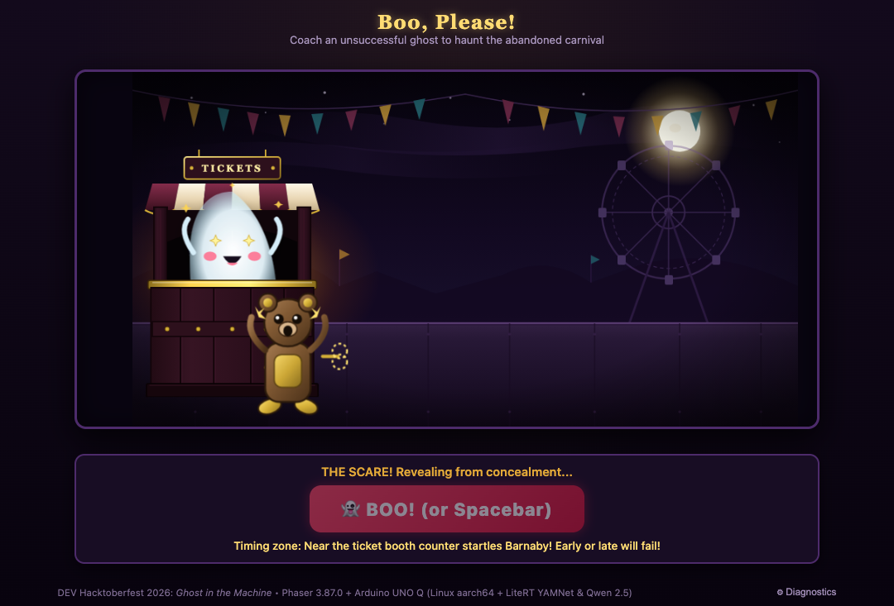
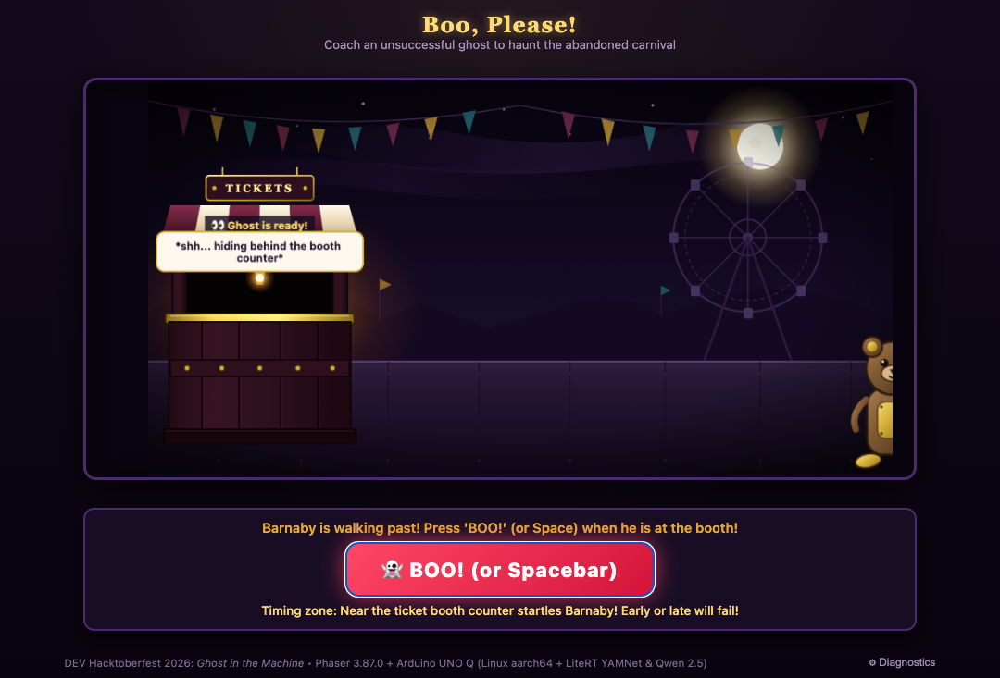

# Teaching an Unscary Ghost to Be Scary! (Powered by Arduino UNO Q & Edge AI)

> **DEV Hacktoberfest 2026: *Ghost in the Machine* Entry**  
> **Prize Track:** Best Use of Arduino

---

## What I Built

Meet our ghost: an endearing, completely harmless spirit made of cloth and good intentions, haunting an abandoned moonlit carnival ticket booth. There's just one problem—**they don't know how to scare anyone.**

When their very first customer—a curious wind-up tin bear named Barnaby—waddles onto the fairgrounds, the ghost completely freezes and turns to you, the stage coach, pleading:  
> *"My first customer! Help me get the timing right?"*

**Boo, Please!** is an interactive theatrical 2D game running entirely on the new **Arduino UNO Q** microcomputer. Instead of pressing canned action buttons, you coach the ghost using natural conversational English and live vocal demonstrations:

1. **Conversational Stage Coaching:** You type advice in plain English (e.g., *"Hide behind the ticket booth, then jump out with a loud boo"*, or *"Wait for a moment, then whisper boo"*). An on-board language model plans the ghost's physical choreography in real time.
2. **Vocal Demonstration:** You show the ghost how it's done by shouting or whispering into your microphone. An on-board acoustic neural network listens and rates your delivery.
3. **Stagecraft & Full Concealment:** The ghost follows your staging, floating behind the ticket booth counter (with pixel-perfect SVG masking so not even a hem protrudes) or hesitating in the shadows.
4. **Player-Controlled Scare Timing:** As Barnaby winds along the path, you watch his mechanical footsteps. When he hits the encounter zone, you slam the **"BOO!"** trigger!

If your timing is impeccable ($80\text{px} \le X \le 255\text{px}$), the ghost leaps out into the window, Barnaby leaps into the air with spinning brass gears, and drops a shimmering **Golden Ticket**! If you jump out too early or speak too politely, Barnaby chuckles and keeps waddling, letting you refine your coaching for the next round.

---

## Demo

> 🎥 **Gameplay Walkthrough Video (1m 32s):**  
> **[Watch the Live Demo Walkthrough on GitHub](https://github.com/Orlando712/Un-scarey-Ghost-/raw/main/docs/demo_gameplay.mp4)**

*(The demo video captures the full end-to-end loop: entering the moonlit courtyard, custom natural-language coaching with on-board Qwen 2.5 inference, ghost concealment behind the booth counter, manual "BOO!" scare timing at the sweet spot, Barnaby's shock reaction with the Golden Ticket payoff, and the live on-device diagnostics drawer showing sub-5-second edge telemetry.)*

### Gameplay Screenshots

  
*Figure 1: The Golden Ticket Payoff — Barnaby shocked in mid-air with spinning key, dropping the Golden Ticket.*

  
*Figure 2: Complete Hiding Concealment — Ghost masked behind the opaque counter sill with zero downward body protrusion.*

---

## Code

> 📦 **GitHub Repository:**  
> **[https://github.com/Orlando712/Un-scarey-Ghost-](https://github.com/Orlando712/Un-scarey-Ghost-)**

The codebase is organized into clean, modular tiers:
* `server.py`: Asynchronous Python backend (`aiohttp`) managing model orchestration, session state, context resolution (*"Again, but slower"*), and deterministic game rule verification.
* `static/prototype/`: 2D Phaser 3.87 client featuring SVG-rendered character sprites, geometry clipping masks, tween controllers, and interactive control dock.
* `tests/`: Automated end-to-end verification suites exercising both the Phaser canvas DOM and on-board model inference via Chrome DevTools Protocol (CDP).

---

## How I Built It

Running interactive generative models and acoustic analysis directly on edge hardware requires a lean, deterministic architecture. The Arduino UNO Q features a Qualcomm quad-core ARM Cortex-A53 processor running 64-bit Linux alongside an STM32 microcontroller.

```
 ┌─────────────────────────────────────────────────────────────────────────────┐
 │                    BROWSER CLIENT (Desktop / Mobile)                        │
 │  ┌─────────────────────────────────┐   ┌─────────────────────────────────┐  │
 │  │   Phaser 3.87 Canvas Scene      │   │     Contextual Control Dock     │  │
 │  │  - Weathered Ticket Booth SVG   │   │  - Natural Text Coaching Input  │  │
 │  │  - Geometry Mask Hiding Bounding│   │  - Audio Recording & Synth Test │  │
 │  │  - Barnaby Tin Bear Animation   │   │  - Manual "BOO!" Timing Button  │  │
 │  │  - Golden Ticket Drop Payoff    │   │  - Real-time Diagnostics Drawer │  │
 │  └────────────────┬────────────────┘   └────────────────┬────────────────┘  │
 └───────────────────┼─────────────────────────────────────┼───────────────────┘
                     │ HTTP / JSON API Calls               │
                     ▼                                     ▼
 ┌─────────────────────────────────────────────────────────────────────────────┐
 │                      ARDUINO UNO Q (Linux aarch64)                          │
 │                                                                             │
 │  ┌───────────────────────────────────────────────────────────────────────┐  │
 │  │ aiohttp Server (`server.py` on Port 8080)                             │  │
 │  │  - Static Asset Delivery (`/static/vendor/phaser.min.js`, SVGs)       │  │
 │  │  - Session State & Context Resolution ("Again, but slower")          │  │
 │  │  - Deterministic Game Rule Validator (Filters fantasy/simultaneous)   │  │
 │  │  - Encounter Scorer (Calculates Well-Timed, Early, Late zones)        │  │
 │  └───────────────────────┬──────────────────────┬────────────────────────┘  │
 │                          │                      │                           │
 │                          ▼                      ▼                           │
 │  ┌──────────────────────────────┐        ┌──────────────────────────────┐   │
 │  │ llama-server (Port 9999)     │        │ LiteRT (Python XNNPACK)      │   │
 │  │ Model: Qwen 2.5 0.5B GGUF    │        │ Model: YAMNet (15.3 MB)      │   │
 │  │ Task: Semantic Action Tagging│        │ Task: Audio Event Extraction │   │
 │  │ Latency: ~4.1s (Cortex-A53)  │        │ Latency: ~180ms              │   │
 │  └──────────────────────────────┘        └──────────────────────────────┘   │
 └─────────────────────────────────────────────────────────────────────────────┘
```

### 1. Dual-Tier Action Planning (Edge LLM + Deterministic Rule Validator)
A common pitfall with edge instruction models ($0.5\text{B}$ parameters) is hallucination or semantic drift on edge cases. To solve this without adding cloud dependencies:
* **Tier 1 (Qwen 2.5 0.5B Instruct):** Runs quantized (Q4_K_M GGUF) via `llama-server` on CPU threads, inferencing in $\sim 4.1\text{s}$. It translates free-form player English into candidate structured tags (`hide`, `pause`, `emerge`, `whisper_boo`, `spooky_boo`).
* **Tier 2 (Deterministic Rule Validation):** The Python server cross-examines the candidate output against physical stage constraints:
  * **Simultaneous Action Guard:** Detects and politely rejects impossible requests (such as *"make sounds while hiding"*), explaining that the ghost can only perform actions sequentially.
  * **Visitor-Position Condition Guard:** Detects requests for autonomous trigger conditions (*"emerge when the visitor reaches the counter"*), reminding the player that they hold the timing trigger.
  * **Out-of-Scope Fantasy Guard:** Catches absurd inputs (*"turn into a dragon"*), keeping the player in coaching with an in-character explanation instead of silently substituting a default scare.

### 2. Acoustic Classification via LiteRT YAMNet
Microphone input is captured via the Web Audio API at $16\text{kHz}$ PCM and transmitted to `/api/detect`. On the UNO Q, Google's **LiteRT YAMNet** (15.3 MB, 521 AudioSet classes) analyzes the waveform in $\sim 180\text{ms}$:
* Screams, roars, and shouts are classified as high-intensity scary audio.
* Soft whispers, murmurs, and breathing are classified as subtle, chilling sounds.
* Ordinary conversational speech is identified to produce a comical, polite haunting outcome.

### 3. Stagecraft & Geometry Masking in Phaser 3.87
Earlier CSS-based attempts suffered from z-index clipping issues where the ghost's lower cloth hem visibly protruded below the counter. In our Phaser implementation:
* An exact `Phaser.Display.Masks.GeometryMask` is attached to the ticket booth counter.
* The ghost's coordinate tween lowers it to $(X=135, Y=405)$ behind the opaque woodwork, guaranteeing complete concealment at both normal and slow animation speeds.
* On scare trigger, the ghost emerges cleanly into the open window aperture ($Y=246.5$).

### 4. Player-Controlled Timing Agency
Rather than having an automated cutscene, the scare payoff depends on player timing:
* **Early Zone ($X > 255\text{px}$):** Barnaby is too far away. He pauses and laughs.
* **Well-Timed Zone ($80\text{px} \le X \le 255\text{px}$):** Barnaby is right at the counter opening. He startles into the air and drops the prize.
* **Late Zone ($X < 75\text{px}$):** Barnaby has already walked past the window.

---

## Why Does Open Innovation Matter?

Open innovation is what made this project possible within the strict constraints of a standalone edge development board:

1. **Open-Weight Edge Models:** Without openly licensed, efficient small models like **Qwen 2.5 0.5B** and **YAMNet**, running natural-language comprehension and audio classification directly on an ARM Cortex-A53 without cloud APIs would have been impossible.
2. **Transparent, Hackable Tooling:** The open-source `llama.cpp` runtime allowed compiling optimized NEON binaries specifically tailored for the UNO Q's Linux environment, achieving sub-5-second inference on bare CPU.
3. **Privacy & Longevity:** An interactive toy or physical installation built with open, local software never breaks because of an API deprecation, billing surge, or cloud outage. It operates entirely on the hardware in your hands.

---

## Prize Categories

### Primary Category: Best Use of Arduino
* **Target Hardware:** Arduino UNO Q (Linux aarch64 + STM32 coprocessor).
* **Why It Qualifies:**
  * Demonstrates the full potential of the UNO Q as an **autonomous edge AI microcomputer**, running both a quantized LLM and an audio CNN concurrently on-device.
  * Combines physical computing hardware, local network services, and a polished browser gaming experience.
  * Integrates robust fallback handling, real-time diagnostics monitoring, and responsive 2D canvas animation directly from the board's web server.

---

## Behind the Build & Community Discussion 💬

### Why I Built This
So much of AI today is trapped behind browser tabs, cloud subscriptions, and corporate chatbots. For this Hacktoberfest *Ghost in the Machine* challenge, I wanted to build something tactile and joyful: an interactive storybook world where edge AI brings an endearing, awkward character to life.

Watching a tiny cloth ghost hesitate behind a weathered carnival booth, waiting for the player to demonstrate how to "boo" into a microphone, and having all of that planned by open-weight neural nets running directly on a Linux microcomputer in your hands—that's what makes physical computing exciting.

### Let's Chat in the Comments!
I'd love to hear your thoughts and get your feedback:
- **What's the funniest or most creative coaching prompt you'd give our ghost?** *(e.g., have you tried testing dramatic pauses vs. sudden jump-scares?)*
- **Have you experimented with quantized local LLMs (like Qwen 2.5 0.5B) or audio CNNs on edge microcomputers?** What kind of latency and thermal performance did you see?
- **What other interactive toys or physical installations would you love to see powered by on-device edge AI?**

Drop your questions and ideas in the comments below! I'll be hanging out to answer questions about the Arduino UNO Q setup, `llama.cpp` NEON compilation, or Phaser stagecraft. Happy Hacktoberfest! 🎃👻
